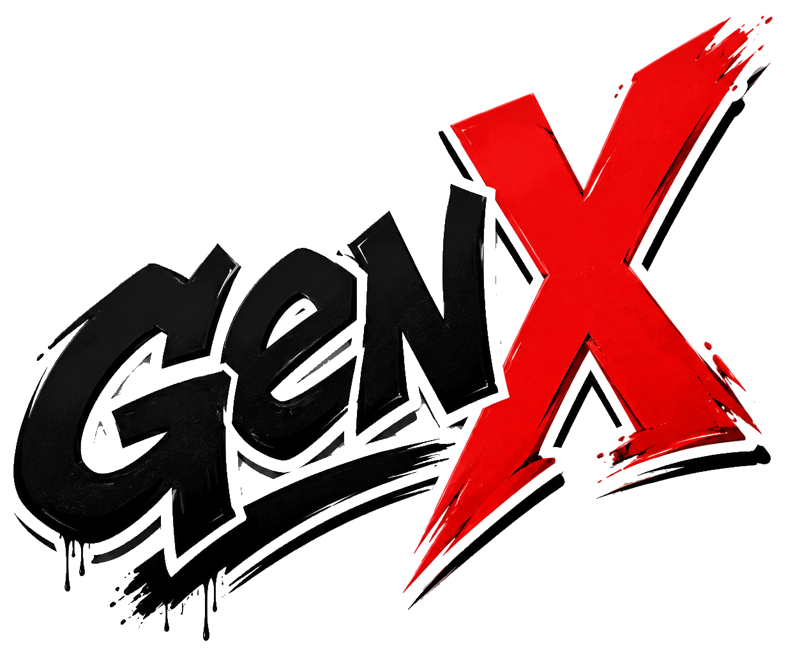

<p align="center">
  
</p>

# GenX

GenX is a Sega emulator for Windows, written from scratch in C++20. One program
plays:

- **Genesis / Mega Drive**
- **32X**
- **Sega CD / Mega-CD**
- **Game Gear**
- **Master System**

It also has netplay, light guns, the Miracle Piano and Game Genie codes.

GenX does not come with any games or BIOS files. You need your own.

**[Download the latest release](https://github.com/GamesExObscura/GenX/releases/latest)** · [FAQ](FAQ.md) · [Report a bug](https://github.com/GamesExObscura/GenX/issues)

---

## Features

**Systems**
- Genesis / Mega Drive cartridges. That includes battery and EEPROM saves and
  the SVP chip used by Virtua Racing.
- 32X. GenX has its own start-up code, so the three 32X BIOS files are
  optional.
- Sega CD / Mega-CD from `.cue`/`.bin`, `.iso` or `.chd`. Disc swapping works,
  and you can boot the BIOS with no disc to reach its CD player and memory
  manager. Sega CD 32X discs work too.
- Game Gear, and Master System through the same core.
- ROMs can be loaded straight from `.zip` files.

**Playing**
- 10 save states per game.
- Rewind and fast forward while a key is held.
- Turbo (auto-fire).
- Keyboard, XInput (Xbox-style) and DirectInput controllers.
- 3-button and 6-button pads, with a saved controller profile for each player.
- **Light guns.** The Menacer and the Justifier are aimed with the mouse. Two
  players can each use their own mouse with a Justifier.
- **Miracle Piano Teaching System**, with an on-screen keyboard. The keyboard
  can be opened in its own window and played with a mouse, or by touch on a
  touch screen like a tablet.
- **Game Genie** codes for the Genesis, Game Gear and Master System, kept per
  game.

**Multiplayer**
- **Netplay.** Two players over a network or the internet, on Genesis, 32X and
  Sega CD games. The session is encrypted with a passphrase, and controller
  types and light guns are carried over.
- **Gear Link.** Two Game Gears side by side, joined by the link cable, for
  two players on the same PC. Gear Link also works over netplay, with each
  player on their own PC.

**Display and sound**
- Window scale from 1x to 4x, plus fullscreen.
- Aspect ratio: stretch, 4:3, 16:9 or a custom size.
- CRT scanline filter and pixel smoothing.
- FPS counter, and dark or light theme.
- The console's own low-pass output filter (optional) and a volume control.
- Mute switches for each sound chip, and recording to WAV.

**Diagnostics**
- One key (Ctrl+L) writes a diagnostic log covering the loaded game, the
  controllers and where your key presses went.

## Compatibility

GenX is tested with automated checks. Each game is started and checked to
reach its title screen or gameplay, and its save states are saved and loaded
back.

Every Genesis / Mega Drive, 32X, Sega CD (including Sega CD 32X) and Game Gear
game tested so far starts. Master System support is newer and has had less
testing.

Starting isn't the same as being perfect, so bug reports are welcome.

## Getting started

1. Download `GenX-<version>-win64.zip` from
   [Releases](https://github.com/GamesExObscura/GenX/releases) and unzip it
   anywhere. There's no installer.
2. Run `genx.exe`. If Windows SmartScreen warns about an unknown publisher,
   choose **More info → Run anyway**. The [FAQ](FAQ.md) explains why.
3. Load a game with **File → Open ROM** and pick the system.
4. Set up controls in **Emulation → Configure → Input**.
5. **Sega CD only:** point **Configure → BIOS** at the folder holding your
   Sega CD BIOS images. A disc only boots with the BIOS for its own region.

Settings, saves, save states and logs live in `%APPDATA%\GenX`. **File → Open
GenX folder** takes you there.

## Default controls

Everything below can be changed in **Configure → Input** and **Configure →
Hotkeys**.

**Player 1 (keyboard):**
- D-pad: arrow keys
- A / B / C: Z / X / C
- X / Y / Z: A / S / D
- Start: Enter
- Mode: Tab
- Game Gear and Master System: button 1 is A, button 2 is B

**Player 2:** uses controller 2, with no keyboard keys set until you choose
some.

| Action | Key |
|---|---|
| Open Genesis / Mega Drive ROM | Ctrl+G |
| Open Game Gear / Master System ROM | Ctrl+M |
| Open 32X ROM | Ctrl+X |
| Open Sega CD image | Ctrl+C |
| Pause / resume | Ctrl+P |
| Soft reset / hard reset | Ctrl+R / Ctrl+Shift+R |
| Power off | Ctrl+W |
| Fullscreen | Alt+Enter |
| CRT filter | Ctrl+T |
| Save state 1–10 | Shift+1 … Shift+0 |
| Load state 1–10 | 1 … 0 |
| Fast forward (hold) | `.` |
| Rewind (hold) | `,` |
| Turbo (hold) | `/` |
| Miracle Piano keyboard | M |
| Write diagnostic log | Ctrl+L |
| Quit GenX | Esc |

## Known issues

- **Sega CD BIOS versions:** US v2.21 is the most tested. If a disc won't
  start, try that BIOS.
- **Platforms:** Windows only. GenX is built directly on the Windows APIs.

## Building from source

**Requirements:**
- Windows 10 or 11 (x64)
- Visual Studio 2022 with the **Desktop development with C++** workload
- CMake 3.20 or newer

```powershell
cmake -S . -B build -G "Visual Studio 17 2022" -A x64
cmake --build build --config Release
```

The emulator is `build\Release\genx.exe`. To run the test suites:

```powershell
ctest --test-dir build -C Release
```

The release builds link the C runtime statically, so the exe doesn't need the
Visual C++ Redistributable. To do the same, add this when configuring:
`-DCMAKE_MSVC_RUNTIME_LIBRARY=MultiThreaded`.

**About the source tree:**
- The emulation core is a library called `mercury`. That was the project's
  working name, and only the program you run is branded GenX.
- `src/runtime_win32.cpp` is the Windows front end.
- `src/core` holds the CPUs (68000, Z80, SH-2) and the file formats (ZIP, CHD).
- `src/genesis`, `src/thirtytwox`, `src/segacd` and `src/gamegear` hold the
  systems.
- `src/net` is netplay.
- `src/tests` and `src/tools` hold the test suites and the command-line probes
  used to check the game libraries.

The controller pictures in `res/` are optional. If you remove them, GenX still
builds and draws a plain outline in their place.

## Credits

GenX is written by GamesExObscura.

These projects were used as hardware references while writing GenX:
- Genesis Plus GX
- PicoDrive
- BlastEm
- ares
- the MiSTer S32X core
- the 240p Test Suite
- ZEXDOC / ZEXALL

GenX contains no code from any of them. Where a source comment names one of
these projects, it marks where a hardware fact was checked.

## License

GenX is free software: you can redistribute it and/or modify it under the terms
of the **GNU General Public License, version 3**. See [LICENSE](LICENSE).

Sega, Genesis, Mega Drive, Sega CD, Mega-CD, 32X, Game Gear and Master System
are trademarks of Sega Corporation. GenX is not affiliated with or endorsed by
Sega. Use GenX only with games and BIOS files you own.
